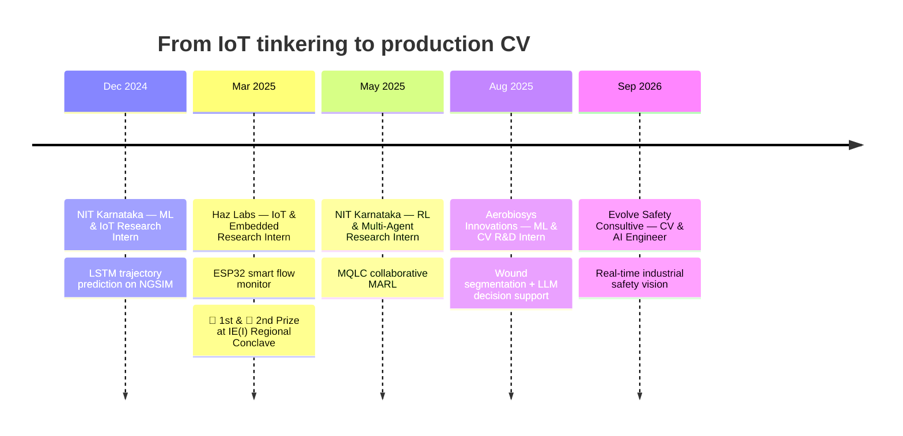

<!-- ═══════════════════════════ HEADER ═══════════════════════════ -->
<p align="center">
  
</p>

<p align="center">
  <a href="https://git.io/typing-svg">
    
  </a>
</p>

<p align="center">
  <a href="https://muhammed-arshad-pk.github.io/"></a>
  <a href="https://www.linkedin.com/in/muhammed-arshad-p-k-691a52281/"></a>
  <a href="mailto:arshadmhd004@gmail.com"></a>
  
</p>

---

## 🧬 About Me


- 🦺 **Computer Vision & AI Engineer** at **Evolve Safety Consultive** — building real-time industrial safety systems (PPE compliance, unsafe behaviour, hazard detection) with **YOLOv8 / YOLO11**
- 🎓 **B.Sc. (Hons. with Research) CS** @ **Pondicherry University** · CGPA **8.93 / 10**
- 🩺 Previously built a **clinical wound-analysis + LLM decision-support** system now running inside a mobile medical app
- 🚗 Researched **multi-agent RL for autonomous driving** at **NIT Karnataka**
- 📄 **IEEE** published author · 🏆 Two-time prize winner at the IE(I) Regional Conclave
- 📍 Puducherry, India 🇮🇳

> *I like problems where a model has to survive contact with the real world — bad lighting, noisy sensors, messy hospitals, busy highways.*

<br clear="right"/>

---

## 🧠 `researcher.ts`

```ts
interface Researcher {
  name: string;
  role: string;
  location: string;
  expertise: string[];
  currentlyShipping: string[];
  funFact: string;
}

const arshad: Researcher = {
  name: "Muhammed Arshad P K",
  role: "Computer Vision & AI Engineer @ Evolve Safety Consultive",
  location: "Puducherry, India 🇮🇳",
  expertise: [
    "Computer Vision",            // detection, segmentation, tracking
    "Deep Learning",              // PyTorch · TensorFlow · Keras
    "Multi-Agent RL",             // CTDE, Q-learning, GCN-GRU
    "LLM-Augmented Systems",      // RAG · LangChain · tool use
    "IoT & Embedded AI",          // ESP32 · Raspberry Pi · Arduino
  ],
  currentlyShipping: [
    "Real-time PPE & hazard detection on live site cameras",
    "Custom YOLO11 models fine-tuned on workplace datasets",
  ],
  funFact: "Calibrated a flow sensor with a 1-litre jug to ±1–2% accuracy 🫗",
};

console.log("Designing AI systems that move from research to real-world impact.");
```

---

## 📊 Impact in Numbers

<div align="center">

| 🎯 | Metric | Where |
|:--:|:--|:--|
| 🩺 | **98–99%** segmentation accuracy · **97%+** wound-area accuracy | Wound Analysis (3,000+ clinical images) |
| 🚗 | **120.41** cumulative reward · up to **2.4×** better than DQN / D3QN / QCOMBO | MQLC Multi-Agent RL |
| 📚 | RAG over **16** textbooks & research papers | NPWT Decision Support |
| 🛣️ | **6.4M** samples · 3s history → **5s** future trajectory | Driver Intention Prediction |
| 💧 | **±1–2%** accuracy over 1–30 L/min · **24×7** uptime | Smart Flow Monitoring |
| ⚡ | Up to **40%** less power wastage | Smart Campus Automation 🥇 |

</div>

---

## 🚀 Featured Projects

<table>
<tr>
<td width="50%" valign="top">

### 🩺 AI Wound Analysis & NPWT Decision Support
**U-Net · K-means · LangChain · Gemini · FastAPI · Gradio**

End-to-end pipeline that segments chronic wounds, classifies tissue (granulation, slough, necrotic, epithelial) and estimates wound area — then feeds it to an **LLM with RAG over 16 clinical sources** to suggest NPWT plans. Deployed into a mobile clinical app.

`98–99% seg. accuracy` `3000+ images` `edge-ready`

</td>
<td width="50%" valign="top">

### 🚗 MQLC — Multi-Agent RL for Lane Changes
**PyTorch · highway-env · GCN-GRU · CTDE**

Collaborative MARL framework where **5 agents** negotiate lane changes among **30 vehicles**. Global–local dual Q-network with GCN-GRU intent prediction and urgency-aware arbitration.

`120.41 reward` `beats DQN/D3QN/QCOMBO by up to 2.4×`

</td>
</tr>
<tr>
<td width="50%" valign="top">

### 🛣️ Driver Intention & Trajectory Prediction
**LSTM Encoder–Decoder · NGSIM**

Maneuver-aware pooling with **polar-coordinate interaction modeling** (orientation, radial velocity) to predict lane changes and merges — outperforming Euclidean pooling.

`6.4M samples` `0.29 val. loss`

</td>
<td width="50%" valign="top">

### 💧 Smart Flow Monitoring (IoT)
**ESP32 · YF-S201 · TFT · Cloud Dashboard**

Real-time flow monitor streaming calibrated data to the cloud, verified through continuous 24×7 field deployment and power-stabilized hardware.

`±1–2% accuracy` `1–30 L/min`

</td>
</tr>
</table>

---

## 🛤️ Journey



<details>
<summary><b>📂 Expand full experience details</b></summary>
<br>

**🦺 Computer Vision & AI Engineer — Evolve Safety Consultive** *(Sep 2026 – Present)*
- Building industrial safety CV systems that analyze camera feeds for PPE compliance, unsafe behaviours and hazardous site conditions
- Training and fine-tuning YOLOv8 / YOLO11 on custom workplace datasets for real-time monitoring

**🩺 ML & CV Intern (R&D) — Aerobiosys Innovations Pvt. Ltd.** *(Aug 2025 – Sep 2026)*
- U-Net multi-class wound segmentation on 3000+ annotated clinical images — 98–99% accuracy, 97%+ area estimation
- K-means (k=10) tissue segmentation with dynamic cluster merging, robust across illumination and wound types
- LLM-powered NPWT decision support (LangChain + Gemini, RAG over 16 sources), shipped via FastAPI into a mobile app

**🚗 Research Intern, RL & Multi-Agent Systems — NIT Karnataka** *(May – Jul 2025)*
- MQLC framework in highway-env: 120.41 cumulative reward in dense traffic, beating DQN, Double DQN, D3QN, QCOMBO
- Global–local Q-network with urgency arbitration and GCN-GRU intent prediction (5 agents, 30 vehicles)
- Reproducible CTDE pipeline: reward shaping, joint-action evaluation, consistency loss

**💧 Research Intern, IoT & Embedded — Haz Labs** *(Mar – Apr 2025)*
- ESP32 + YF-S201 flow monitoring with TFT display and cloud streaming
- 1-litre volumetric calibration → ±1–2% accuracy over 1–30 L/min; 24×7 reliability testing

**🛣️ Research Intern, ML & IoT — NIT Karnataka** *(Dec 2024 – Jan 2025)*
- LSTM encoder–decoder with maneuver-aware polar pooling on NGSIM (6.4M samples)
- Masked MSE + Adam on GPU: 0.23 train / 0.29 val loss

</details>

---

## 📄 Publication

> **AI-Enabled Energy Efficient Infrastructures for Real-Time Monitoring Using IoT: An Approach for Sustainable Development**
> *2025 IEEE International Conference on Next-Gen Quantum and Advanced Computing: Algorithms, Security, and Beyond* — Bengaluru, India

## 🏆 Achievements

- 🥇 **1st Prize, Project Competition** — IE(I) 4th Regional Conclave @ PTU (Mar 2025) · *IoT-Based Smart Campus Block Automation* (Node-RED, MQTT, NoSQL, Grafana) — cut power wastage by up to 40%
- 🥈 **2nd Prize, Model/Idea Competition** — IE(I) 4th Regional Conclave @ PTU (Mar 2025) · *IoT-Based Smart Irrigation System* with local processing and minimal internet dependency

---

## 🛠️ Tech Arsenal

<p align="center">
  
  <br/>
  
</p>

<p align="center">
  
  
  
  
  
  
  
  
  
  
  
  
  
</p>

---

## 📈 GitHub Stats

<p align="center">
  
  
</p>

<p align="center">
  
</p>

<p align="center">
  
</p>

<!-- Generated by .github/workflows/snake.yml into the "output" branch -->
<p align="center">
  <picture>
    <source media="(prefers-color-scheme: dark)" srcset="https://raw.githubusercontent.com/muhammed-arshad-pk/muhammed-arshad-pk/output/github-snake-dark.svg"/>
    
  </picture>
</p>

---

<p align="center">
  <i>💬 Open to research collaborations in computer vision, medical AI, and multi-agent systems — let's build something that works outside the lab.</i>
</p>

<p align="center">
  
</p>
